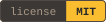
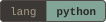
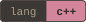
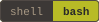
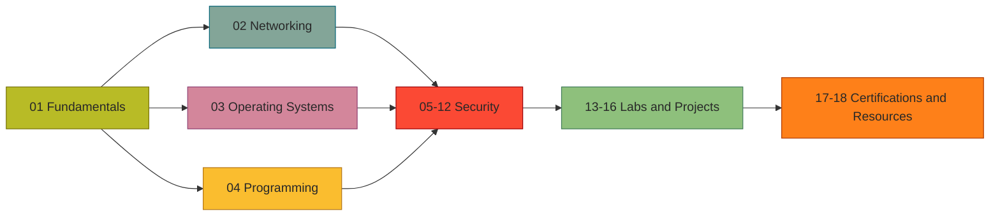
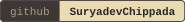
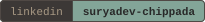

  

  
  
  
  
  

  <a href="#about">About</a> &nbsp;·&nbsp;
  <a href="#learning-areas">Learning Areas</a> &nbsp;·&nbsp;
  <a href="ROADMAP.md">Roadmap</a> &nbsp;·&nbsp;
  <a href="#ethics">Ethics</a> &nbsp;·&nbsp;
  <a href="#contact">Contact</a>

## About

I am a university student working toward a career in cybersecurity. This repository is where I document what I learn and build along the way.

It is organized by learning area and grows as I study, practise and complete my own work. My plan is in [ROADMAP.md](ROADMAP.md).

## Learning Areas

Each area is colour-coded by category.

  
  
  
  
  
  
  

| # | Area | Category | Purpose |
| :-: | --- | --- | --- |
| `01` | [Fundamentals](01-Fundamentals/) |  | Documents my learning in computer science and security fundamentals. |
| `02` | [Networking](02-Networking/) |  | Documents my learning and practical experience in computer networking and network security. |
| `03` | [Operating Systems](03-Operating-Systems/) |  | Documents my learning and practical experience with operating systems and their security. |
| `04` | [Programming](04-Programming/) |  | Contains my programming and scripting work related to cybersecurity. |
| `05` | [Cryptography](05-Cryptography/) |  | Documents my learning in cryptography and its practical applications. |
| `06` | [Web Security](06-Web-Security/) |  | Documents my learning and practical experience in web and application security. |
| `07` | [Offensive Security](07-Offensive-Security/) |  | Documents my learning in offensive security, practised only in authorized environments. |
| `08` | [Defensive Security](08-Defensive-Security/) |  | Documents my learning and practical experience in defensive security, monitoring and detection. |
| `09` | [Digital Forensics](09-Digital-Forensics/) |  | Documents my learning in digital forensics and incident response. |
| `10` | [Cloud Security](10-Cloud-Security/) |  | Documents my learning and practical experience in cloud security. |
| `11` | [Reverse Engineering](11-Reverse-Engineering/) |  | Documents my learning in reverse engineering and binary analysis. |
| `12` | [Security Engineering](12-Security-Engineering/) |  | Documents my learning in designing and building secure systems. |
| `13` | [CTF Writeups](13-CTF-Writeups/) |  | Contains my writeups for capture the flag challenges I attempt. |
| `14` | [Hands-on Labs](14-Hands-on-Labs/) |  | Contains my notes and results from practical security labs. |
| `15` | [Projects](15-Projects/) |  | Contains the security projects I build. |
| `16` | [Security Research](16-Security-Research/) |  | Contains my security research. |
| `17` | [Certifications](17-Certifications/) |  | Documents the certifications I pursue. |
| `18` | [Resources](18-Resources/) |  | Contains resources I have found useful in my learning. |

## Ethics

> [!IMPORTANT]
> All security testing documented here is performed only on systems I own or have explicit permission to test, such as personal labs and authorized training platforms. Nothing in this repository is intended for unauthorized or malicious use.

## Contact

  
  

Maintained by Suryadev Chippada &nbsp;·&nbsp; Released under the <a href="LICENSE">MIT License</a>

